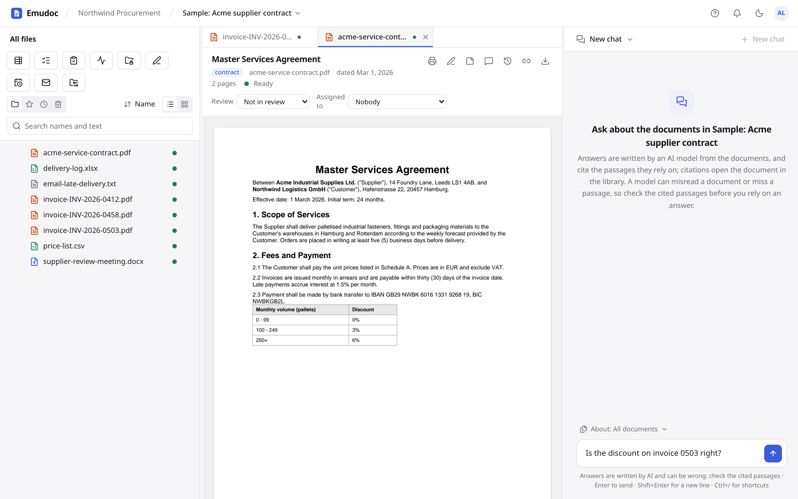

# Emudoc

Emudoc keeps your team's documents in projects, with an agent that works on them. Upload
contracts, invoices, delivery notes and price lists, and ask in your own words: "Does invoice
0503 apply the volume discount the contract sets?" The agent searches the documents and reads
them, queries the facts read from every one of them and compares them, and writes the letter or
the workbook that follows into your own files. Every claim cites the passage it came from, and a
citation opens the document at that passage.

It is free software that your team runs on its own server, with the AI models of the provider
you choose.



## What it does

- **Ask** about a project, a folder or a few chosen documents. The agent lists the documents,
  reads their outlines, searches the passages by their words and their meaning, reads them, and
  cites what it used. Chats are private until you share them with the project; an answer or a
  chat downloads as Word, PDF or Markdown.
- **Read anything**: PDF, Word, Excel, PowerPoint, RTF, HTML, CSV, text and Markdown, photos and
  scans, emails with their attachments, and ZIP archives. Each document is parsed once into its
  outline, its passages and its facts, and searched by its words and by their meaning.
- **Compare**: each document's parties, numbers, dates, amounts and terms are read as it is
  indexed, each with the words it came from. Ask "which invoices are over 5,000 EUR?", or to
  check an invoice against its purchase order, the contract and the price list, and the agent
  queries the facts across the documents and compares them, citing where each figure is written.
- **Create**: the agent writes letters, replies, memos and reports from the documents as Word
  documents into your own My files, to whatever outline you give it, and makes and edits Excel
  workbooks there; ask in a chat for a disputed invoice's dispute letter and it is in your files.
- **Work together**: a workspace with roles, private projects, notices, and links that share a
  document or an answer outside.
- **Bring documents in** by upload, by an upload client that sends a folder, by mail to a
  project's address, from Google Drive, Dropbox or OneDrive folders, or through the API.
- **Run it yourself**: one image and one compose file, a setup page on first visit, backups in
  one command, an Administration page for the work, the services and what the models cost, a
  daily spending cap, an audit log, a versioned API with keys, and webhooks.

## Quick start

On a server with Docker, a name that leads to it and ports 80 and 443 open:

```bash
mkdir emudoc && cd emudoc
curl -fsSLO https://raw.githubusercontent.com/adityaviki/emudoc/v0.2.0/deploy/compose.yml
curl -fsSL -o .env https://raw.githubusercontent.com/adityaviki/emudoc/v0.2.0/deploy/.env.example
chmod 600 .env && sed -i "s|^POSTGRES_PASSWORD=$|&$(openssl rand -hex 24)|; s|^ENCRYPTION_KEYS=$|&$(openssl rand -base64 32)|" .env
docker compose up -d --wait          # after setting APP_URL, a model's key and COMPOSE_PROFILES in .env
```

The fourth line makes the database's password and the key the database's secrets are encrypted
with: keep a copy of `.env` apart from the backups. In `.env`, set `APP_URL` to the address
people will open, the models and their provider's key (Gemini's by default), and
`COMPOSE_PROFILES=tls` for Caddy to answer on 80 and 443 with a certificate from Let's Encrypt,
adding `scan` for ClamAV and `office` for Word, PowerPoint and Excel files shown as they look.
Then open `APP_URL`: a new install opens its setup page, which makes the first account and the
workspace.

`docker compose up -d --wait` starts Postgres with pgvector, applies the migrations, and starts
the API, a worker and the embeddings server. `docker compose run --rm backup` writes a backup of
the database and the files, to run every night from a timer and copy off the server. The
self-hosting guide, [`deploying.md`](deploying.md), takes it from there: the install step by
step, the models, the proxy, mail, sign-in with Google or Microsoft, backups, upgrades and
monitoring. The image is `ghcr.io/adityaviki/emudoc`, published for each release; to run one you
built from a checkout ([`docs/development.md`](docs/development.md), "The image"), name it in
`.env` as `EMUDOC_IMAGE=emudoc:<commit>`.

## Models

Emudoc uses two models through their providers' APIs: one reads each document once, for its
outline's summaries, its facts and the text of scanned pages, and one answers. Each is named as
`provider:model`, such as `google:gemini-3.5-flash-lite` (the default), `anthropic:…`,
`openai:…`, `openrouter:…` or `google-cloud:…` for Vertex AI, or an OpenAI-compatible server,
each with a fallback of another provider for when the first cannot answer. Your team pays its
provider directly: Emudoc counts the tokens and their cost, shows them to the workspace's admins,
and stops at a daily cap if you set one. The documents go to the provider you choose, so choose
one whose terms forbid training on what it is sent ([`deploying.md`](deploying.md), "The models"
and "What leaves the deployment").

Search by meaning uses EmbeddingGemma, run beside the app by llama.cpp's server from the compose
file, so passages and questions are embedded on your own server.

## What works without what

| Missing          | Still works                                           | Does not                                          |
| ---------------- | ----------------------------------------------------- | ------------------------------------------------- |
| Model API key    | Parsing, outlines from headings, search, the viewer   | Summaries, facts, scans and images, the Ask tab   |
| Embeddings       | Keyword search, everything else                       | Search by meaning                                 |
| ClamAV           | Everything; each document says it was not scanned     | Malware scanning of uploads                       |
| Converter        | Everything; Office files are shown by their text      | Word, PowerPoint and Excel files shown as they look |
| Mail relay       | Everything; admins hand invitation and password links on, notices stay in the app | Mail |

The Ask tab says when the model is out of reach, and a search when it matched keywords only. A
deployment's members are told only what they cannot do for now; the reason is in the log, the
metrics and the alerts. After adding a key, restart and press "Index the rest" in the library to
finish what was indexed without it. A production start refuses to run without a model or the
embeddings, and warns about the rest.

## Documentation

- [`deploying.md`](deploying.md): the self-hosting guide, from the install to the runbooks, and
  every setting the app reads.
- The help pages, in the app's help menu: how members use Emudoc, filled in for your install.
- [`docs/architecture.md`](docs/architecture.md): how it works and where the code is.
- [`docs/development.md`](docs/development.md): running it from a checkout, and the tests.
- [`CONTRIBUTING.md`](CONTRIBUTING.md): how to contribute; [`SECURITY.md`](SECURITY.md): how to
  report a vulnerability; [`CODE_OF_CONDUCT.md`](CODE_OF_CONDUCT.md).
- [`CHANGELOG.md`](CHANGELOG.md): what each release changes, for users and for admins.
- The versioned API's contract, at `/api/v1/openapi.json` on any install.

## Licence

Emudoc is free software under the GNU Affero General Public License, version 3 only
([`LICENSE`](LICENSE)); [`NOTICE`](NOTICE) names the other projects' software it uses. The help
menu's "Source code" offers the running version's source to whoever uses an install, as the
licence asks. Contributors sign the contributor licence agreement ([`CLA.md`](CLA.md)), which
`CONTRIBUTING.md` explains. The name and the logo are not covered by the licence:
[`TRADEMARKS.md`](TRADEMARKS.md) says how they may be used.
